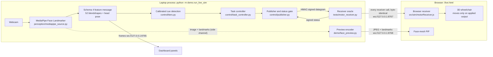
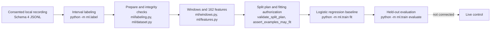
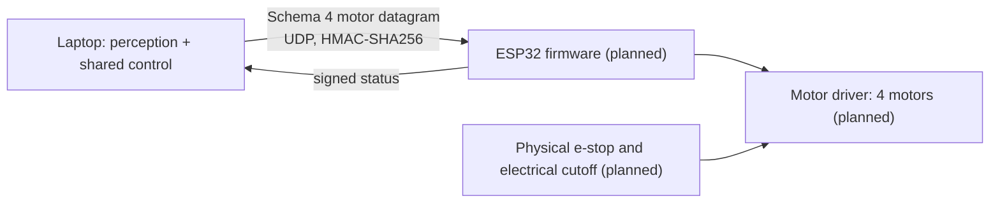

# Sojourner

**Facial-movement control for an assistive mobility platform, built and tested in software first.**

Sojourner is a WHACK 2026 research prototype from a four-person team. It asks whether a person who cannot rely on a joystick, sip-and-puff switch or hand control can steer a mobility platform with small, deliberate facial movements, such as opening the mouth or turning the head, measured by an ordinary laptop camera and calibrated to that person's own range of motion.

The repository contains a working end-to-end **software** system:

- A **perception** stage runs Google's MediaPipe Face Landmarker on a webcam and publishes a versioned feature stream: 52 blendshape scores and head pose.
- A **personal calibration** step measures which movements this person can produce reliably, and how far each one moves above resting noise.
- A **shared-control** layer turns calibrated threshold crossings into persistent tasks (Go, Stop, turn, faster, slower). An authority layer allows a motor command only when every safety check passes.
- An **authenticated motor protocol** (HMAC-SHA256, freshness challenges, sequence and session rules, a 250 ms watchdog) is checked by a reference receiver. A line-for-line JavaScript port of that receiver is parity-tested against it.
- A **3D simulator** (React, Three.js) drives a wheelchair model through a corridor and doorway from the same accepted commands.
- A **research ML pipeline** labels recordings, extracts 162-number feature windows, and trains and evaluates an offline classifier with participant-separated splits.

> **Status, plainly.** Sojourner is not a medical device. It has not been clinically evaluated, and nothing here has been validated on a physical wheelchair or rover. The ESP32 firmware and motor hardware are **not in this repository yet**. The live demonstration drives a **simulated** wheelchair through an in-process software receiver. The offline ML classifier is a research artifact and **does not control** the live demo.

## Contents

1. [Quick start](#quick-start)
2. [Feature status](#feature-status)
3. [System architecture](#system-architecture)
4. [Technology stack](#technology-stack)
5. [Installation](#installation)
6. [Live facial-control demonstration](#live-facial-control-demonstration)
7. [Personalized calibration](#personalized-calibration)
8. [Machine learning](#machine-learning)
9. [Dataset and data collection](#dataset-and-data-collection)
10. [Safety engineering](#safety-engineering)
11. [3D simulation](#3d-simulation)
12. [Backend and data management](#backend-and-data-management)
13. [Repository structure](#repository-structure)
14. [Testing and verification](#testing-and-verification)
15. [Known limitations and future work](#known-limitations-and-future-work)
16. [Team and contributing](#team-and-contributing)
17. [Responsible use](#responsible-use)

## Quick start

The fastest way to see the system is the **synthetic demo**. It needs no camera and no model file: scripted, labelled synthetic face frames go through the real control pipeline, and the result is mirrored into the 3D simulator.

```bash
git clone https://github.com/TaswarMahbub/Sojourner.git
cd Sojourner
python3 -m venv .venv && source .venv/bin/activate
python3 -m pip install -r requirements.txt

# Terminal 1: the frontend (Node.js 20.19+ or 22.12+)
cd frontend && npm ci && npm run dev

# Terminal 2: from the repository root, with the venv active
python3 -m demo.run_live_sim --synthetic
```

Open **http://localhost:5173/live.html**. In about 30 seconds the wheelchair goes forward, makes one 15° left turn, stops on a cue, resumes, refuses a forged datagram, stops when the face disappears, and halts on the receiver watchdog when the link drops. The readout states that this is a software-only mirror and counts how many receiver calls agree with the Python reference.

For the live camera, see [Installation](#installation) and [Live facial-control demonstration](#live-facial-control-demonstration).

## Feature status

What exists on `main`, and how far each part has been exercised.

| Area | Feature | Status | Where |
| --- | --- | --- | --- |
| Perception | MediaPipe Face Landmarker: 52 blendshapes, facial transformation matrix, tracking state | Implemented, demonstrated live | [`perception/mediapipe_source.py`](perception/mediapipe_source.py) |
| Perception | Schema 4 feature stream over WebSocket, with a synthetic source | Implemented, demonstrated | [`perception/publish.py`](perception/publish.py), [`perception/fake_stream.py`](perception/fake_stream.py) |
| Calibration | 60 s guided calibration and a targeted probe session with SNR, repeatability, latency, fatigue, false-positive and cross-talk metrics | Implemented, used with real participants | [`perception/calibration.py`](perception/calibration.py), [`perception/probe_session.py`](perception/probe_session.py) |
| Control | Cue detection: Tier 2 discrete is used live; Tier 1 proportional and Tier 3 scanning are implemented and tested | Tier 2 demonstrated live; Tiers 1 and 3 tested, not demonstrated | [`control/tiers.py`](control/tiers.py) |
| Control | Cues Go, Stop, Left, Right, Faster, Slower; Through, Confirm and Cancel exist but are not in the live cue map | Implemented, demonstrated live in software | [`control/cue_map.py`](control/cue_map.py), [`control/task.py`](control/task.py) |
| Control | Shared-control task machine, Go lockout, confidence gating | Implemented, tested | [`control/task_controller.py`](control/task_controller.py), [`control/confidence.py`](control/confidence.py) |
| Safety | Authenticated motor command and status (HMAC-SHA256), freshness challenge, sequence and session rules, rearm, 250 ms watchdog | Implemented in the publisher and the reference receiver; tested in software | [`docs/contracts.md`](docs/contracts.md), [`control/publisher.py`](control/publisher.py), [`tests/motor_receiver.py`](tests/motor_receiver.py) |
| Safety | Browser receiver parity with the Python receiver | Implemented, tested on every run | [`frontend/src/sim/motorReceiver.parity.test.js`](frontend/src/sim/motorReceiver.parity.test.js) |
| Simulation | 3D corridor and doorway, primitive-built wheelchair, collision, attempt metrics | Implemented, demonstrated | [`frontend/src/sim/`](frontend/src/sim/), [`frontend/src/view/`](frontend/src/view/) |
| Simulation | Live control mirrored into the 3D scene | Implemented, demonstrated with camera and synthetic input | [`demo/`](demo/), [`frontend/src/live/`](frontend/src/live/) |
| Simulation | Live camera picture-in-picture with face mesh, from the same camera and detector | Implemented, demonstrated | [`demo/face_preview.py`](demo/face_preview.py), [`frontend/src/preview/`](frontend/src/preview/) |
| Evidence | Recording, deterministic replay, stop-latency tables, failure drills | Implemented, tested | [`tests/session_harness.py`](tests/session_harness.py), [`tests/drills.py`](tests/drills.py) |
| ML | Labeling workflow, leakage-checked splits, 162-number features, logistic-regression baseline, baseline-relative mode | Implemented; evaluated on a small local dataset; **not connected to live control** | [`ml/`](ml/) |
| Backend | TimescaleDB schema and loader for derived session data; FastAPI service with scoped tokens | Implemented and tested; **not called by the frontend or the control loop** | [`backend/`](backend/) |
| Hardware | ESP32 firmware, four-motor drive, electrical cutoff, physical emergency stop | **Planned. No firmware in this repository; no bench validation** | [`firmware/README.md`](firmware/README.md) |

## System architecture

### Live software demonstration (implemented)



- **Perception** produces facts about the face and nothing else. **Shared control** is the only publisher of motor commands. The **receiver** alone decides whether a datagram is applied.
- The **policy layer** (`cues.py`, `tiers.py`, `task.py`, `task_controller.py`) proposes at most one motion request per tick. The **authority layer** (`publisher.py`, `status_gate.py`, `session.py`, `auth.py`, `durable.py`) can refuse it, and the policy layer cannot get around it. An AST test in [`tests/test_task_controller.py`](tests/test_task_controller.py) enforces that split. See [`control/README.md`](control/README.md).
- **The bridge does not filter.** [`demo/motor_bridge.py`](demo/motor_bridge.py) forwards every receiver call, including forged or stale datagrams, so the browser's own receiver must judge them and the readout can show each refusal.
- **One camera, one detector.** The face-mesh preview reuses the image and landmarks the control pipeline already computed. It runs on its own thread, drops old frames, and is never on the control path.

### Research ML pipeline (implemented, offline only)



The classifier's output never reaches `control/`. Live control uses the calibrated channels directly. Schema 4 forbids any gesture label other than `neutral` or `unknown` until a reviewed label list exists for a model version (contract section 2), and the publisher enforces that rule.

### Hardware target (planned, not implemented)



The ESP32 is meant to run the same receiver procedure as `tests/motor_receiver.py`, including the watchdog and latches, and to keep the physical emergency stop independent of software. None of this exists as firmware or has been checked on a bench. See [`firmware/README.md`](firmware/README.md).

## Technology stack

Versions are the constraints in the repository's manifests. "Tested locally" lists what this README's checks actually ran with.

| Layer | Technology | Version | Notes |
| --- | --- | --- | --- |
| Language | Python | CI 3.12; tested locally 3.13.3 | [`.github/workflows/tests.yml`](.github/workflows/tests.yml) |
| Perception | MediaPipe Face Landmarker | `mediapipe>=1.2` in [`perception/requirements.txt`](perception/requirements.txt) | The live demo has also run with mediapipe 0.10.32. The model file is not in git |
| Image handling | OpenCV | installed with mediapipe (`opencv-contrib-python`) | Do not also install `opencv-python` |
| ML | scikit-learn, NumPy, SciPy | `scikit-learn>=1.5` | NumPy and SciPy come with scikit-learn |
| Transport | websockets | `websockets>=14` | Localhost-only servers on 8765, 8767 and 8768 |
| Tests | pytest, httpx | `pytest>=8.3`, `httpx>=0.27` | |
| Backend | FastAPI, Uvicorn, psycopg 3 | `fastapi>=0.115`, `uvicorn[standard]>=0.30`, `psycopg[binary]>=3.1`, `psycopg-pool>=3.2` | Optional. Not needed for the demo |
| Database | PostgreSQL with TimescaleDB (Tiger Cloud) | managed service | Derived numbers only |
| Frontend | React, Vite | `react ^19.3.1`, `vite ^8.3.6` | Node.js 20.19+ or 22.12+ |
| 3D | Three.js on WebGL 2, `postprocessing`, `n8ao` | `three 0.187.0`, `postprocessing 6.39.6`, `n8ao 2.0.1` | Falls back to a 2D plan without WebGL 2 |
| Frontend tests | Vitest, ESLint | `vitest ^4.1.12`, `eslint ^10.14.0` | |
| Deployment | Docker, GitHub Container Registry, Caddy on Vultr | [`.github/workflows/deploy-cloud.yml`](.github/workflows/deploy-cloud.yml) | Backend API only |
| Hardware (planned) | ESP32 | none | No firmware yet |

## Installation

Tested on macOS (Apple silicon) with Python 3.13 and on CI's Ubuntu image with Python 3.12. The camera path needs a webcam and permission for your terminal to use it.

### 1. Python environment

```bash
git clone https://github.com/TaswarMahbub/Sojourner.git
cd Sojourner
python3 -m venv .venv
source .venv/bin/activate            # Windows: .venv\Scripts\Activate.ps1
python3 -m pip install -r requirements.txt
python3 -m pip install -r perception/requirements.txt   # camera path only
```

### 2. Frontend

```bash
cd frontend
npm ci
npm run dev        # http://localhost:5173
```

### 3. Face Landmarker model (camera path only)

The model is not committed. Download Google's published Face Landmarker model to the path the code expects:

```bash
mkdir -p perception/models
curl -fL -o perception/models/face_landmarker.task \
  https://storage.googleapis.com/mediapipe-models/face_landmarker/face_landmarker/float16/1/face_landmarker.task
```

Every camera command also accepts `--model PATH`.

### 4. Camera permission

On macOS, the first camera run asks for permission for your terminal under System Settings → Privacy & Security → Camera. If it was denied earlier, enable the terminal there and restart it.

### Pages and ports

| URL or port | What it is |
| --- | --- |
| `http://localhost:5173/live.html` | Live mirror: 3D wheelchair driven by the laptop's control run, plus the face-mesh PiP. Served by the dev server only; the production build does not include it |
| `http://localhost:5173/` | Operator dashboard with a mock camera, calibration envelope, panels, and the drill-driven 3D simulator |
| `http://localhost:5173/?source=live` | Dashboard reading Schema 4 frames from `ws://127.0.0.1:8765` |
| `ws://127.0.0.1:8767` | Motor mirror bridge (`SOJOURNER_MOTOR_BRIDGE_PORT`) |
| `ws://127.0.0.1:8768` | Face preview (`SOJOURNER_PREVIEW_PORT`) |

## Live facial-control demonstration

### Run it

1. **Calibrate once**, about 2.5 minutes, sitting exactly as you will during the demo:

   ```bash
   python3 -m perception.probe_session --source camera --user demo
   # writes captures/calibration/<user>_<session>_probe.jsonl and ..._probe_report.json
   ```

2. **Start the live run**, with the frontend dev server already running:

   ```bash
   python3 -m demo.run_live_sim --probe-report captures/calibration/<...>_probe_report.json --seconds 600
   ```

   - `--record captures/control/<name>.jsonl` keeps the measured frames locally (run `mkdir -p captures/control` first).
   - `--no-face-preview` turns the PiP off.
   - `--no-frame-relay` stops serving frames on 8765.
   - Do **not** also run `perception.publish`: the demo process owns the camera.

3. **Open** `http://localhost:5173/live.html`. To watch the same frames in the dashboard panels, also open `http://localhost:5173/?source=live`.

Without a camera, use `python3 -m demo.run_live_sim --synthetic`. To replay measured frames, use `python3 -m demo.run_live_sim --replay RECORDING.jsonl --probe-report REPORT.json`. Replays are labelled REPLAY, and nothing is re-detected.

### Cues

The cue map is [`control/cue_map.py`](control/cue_map.py). Each side of a channel is relative to **your** measured rest value, and a crossing must hold for **two consecutive tracking frames** (`MIN_SUSTAINED_FRAMES`). A side re-arms only after the value returns inside its deadband.

| Movement | While in Hold | While moving | Effect |
| --- | --- | --- | --- |
| Open mouth (`jawOpen` above rest) | **Go** | **Stop** | Go starts forward motion at the current speed setting. Any jaw press while moving is Stop |
| Turn head left (`yaw_deg` above rest) | Queued until Go | **Left** | One heading increment of 15° (0.2618 rad) at 0.5 rad/s, then the previous task continues |
| Turn head right (`yaw_deg` below rest) | Queued until Go | **Right** | Same, to the right |
| Lift head (`pitch_deg` above rest) | Changes the setting | **Faster** | +0.05 m/s, clamped to [0.05, 0.30]; default 0.10 |
| Lower head (`pitch_deg` below rest) | Changes the setting | **Slower** | −0.05 m/s |
| Face lost, frame stale or invalid | — | **Stop** | Plus a 2.5 s Go lockout that discards a pending turn and resets the speed |

Nobody has to hold a gesture to keep moving. A cue changes a persistent task, and the task runs until another cue or a stop. Roll is deliberately unbound: tilting the head also turns it, and the cross-talk measurements are in the `cue_map.py` docstring. All of these numbers are marked provisional in the source.

**Keep head turns moderate.** One recorded probe session lost the face every time the head passed roughly 44–58° of yaw. Losing the face is a safety stop, and the lockout cancels the pending turn, so an exaggerated turn stops the chair instead of turning it. About 25–35°, held for a moment, crosses a typical calibrated threshold and keeps the face tracked.

### Face-mesh picture-in-picture

`CameraSource` hands the image it already captured, and the landmarks its single detector already produced, to a preview callback after the Schema 4 message is built. The callback stores references and returns, in microseconds. A separate thread downsizes the image to 320 px and JPEG-encodes it, at most 10 times a second and only while a browser is connected, then serves it on 8768. A newer frame replaces an unsent one. Nothing is recorded.

The panel says **LIVE CAMERA** only for the real camera, **TEST FIXTURE** for `python3 -m demo.preview_fixture`, and **DISCONNECTED** otherwise. The mesh is hidden while tracking is lost, and the image and mesh are cleared after 1 s without a frame. The Mirror button flips only the picture; head-pose signs are unaffected. A preview failure switches the preview off and leaves the camera and control loop running.

### Troubleshooting

| Symptom | Likely cause and fix |
| --- | --- |
| `camera could not start` or a black image | Terminal lacks camera permission (see [Camera permission](#4-camera-permission)), or another app holds the camera. Close it and do not run `perception.publish` alongside the demo |
| `Face Landmarker model not found` | Download the model to `perception/models/face_landmarker.task`, or pass `--model` |
| `address already in use` | Another demo is still running on 8765, 8767 or 8768. Stop it, or set `SOJOURNER_MOTOR_BRIDGE_PORT` / `SOJOURNER_PREVIEW_PORT`. The frontend reads `VITE_MOTOR_BRIDGE_PORT` / `VITE_FACE_PREVIEW_PORT` at dev-server start |
| PiP shows DISCONNECTED | No live camera run is serving 8768. `--synthetic` and `--replay` serve no preview by design |
| PiP image without mesh | Tracking is `lost` (face turned too far, out of frame, or poorly lit). The mesh is hidden on purpose |
| A head gesture never fires | Its side never armed: your resting pose sits outside the calibrated deadband, for example resting pitch above `deadband.upper`. Recalibrate in the demo posture |
| Movements fire unexpectedly or not at all after moving the laptop | Calibration is posture-specific. Recalibrate after changing seat, camera or screen angle |
| Turns stop the chair | Head turned past the tracking range. Turn less; see above |
| `live.html` shows a 2D plan instead of 3D | WebGL 2 is unavailable in the browser. Enable hardware acceleration |
| Readout says `halted watchdog` | No accepted datagram for 250 ms: the run ended, the link dropped, or the machine stalled. The latch needs a new run; it does not clear itself |
| Readout shows `DISAGREE` | The browser receiver and the Python reference reached different verdicts. Treat it as a bug and report it with the run's transcript |

Do not lower thresholds, lengthen the watchdog or shorten the lockout to make a demonstration easier. Those values are reviewed safety parameters (see [`CONTRIBUTING.md`](CONTRIBUTING.md)).

## Personalized calibration

Calibration is **system identification, not model training**. A session is a short input-output experiment on one person: prompts are the input, channel trajectories are the output, and the only statistics computed are means, standard deviations and correlations ([`perception/calibration.py`](perception/calibration.py)).

- **Rest reference.** Every threshold is relative to the channel's measured rest mean. A laptop camera sits below eye level, and resting head pitch is often several degrees from zero. The standard deviation used is `max(std, noise_floor)`, so a perfectly still channel cannot produce an infinite SNR.
- **Thresholds and deadbands.** In the 60-second calibration, activation is `rest ± max(5 σ_eff, floor)` and the deadband is `rest ± 3 σ_eff`. The targeted probe session ([`perception/probe_session.py`](perception/probe_session.py)) uses `rest ± max(5 σ, unit floor, 0.33 × voluntary range)`, so the threshold scales with how far that person actually moves.
- **Sustained activation.** A crossing counts only after two consecutive tracking frames beyond the threshold, the same rule control uses.
- **Metrics per channel:**
  - usable range;
  - SNR, the only metric comparable across units;
  - repeatability (coefficient of variation of repetition peaks);
  - independence (correlation clusters, where only the best channel of a cluster may be bound);
  - onset latency from the prompt;
  - fatigue drift (last peak minus first);
  - false positives.
- **False positives are measured on held-out rest**, never on the rest period the threshold came from, which would be circular. Any held-out false positive disqualifies a channel.
- **Tier proposal.** The ranked channels propose Tier 1 (proportional), Tier 2 (discrete) or Tier 3 (scanning). The live demo uses Tier 2 with the cue map above.
- **Profiles.** `perception.calibrate` writes a `calibration_profile` record. `demo.run_live_sim` builds a Tier 2 profile from a probe report with `perception.probe_session.profile_from_report`. Calibration profiles are perception's own format, not part of `docs/contracts.md`.

Rest is measured at the end of the session. If you sit differently during the demo, a resting pose can land outside a deadband and the detector on that side never arms.

## Machine learning

### A. Perception: a pretrained extractor

MediaPipe Face Landmarker is used as-is. Per frame it returns 478 landmarks, 52 blendshape scores in [0, 1] (including `_neutral`), and a 4×4 facial transformation matrix. [`perception/frame_builder.py`](perception/frame_builder.py) validates the matrix against the Schema 4 pose rules and publishes yaw, pitch and roll. Nothing in Sojourner retrains MediaPipe.

### B. Feature engineering

[`ml/features.py`](ml/features.py) turns a window of accepted, actionable frames into a fixed 162-number vector:

- 54 channels: the 51 blendshapes other than `_neutral`, then `yaw_deg`, `pitch_deg` and `roll_deg`.
- For each channel: the mean, the population standard deviation, and the newest value minus the oldest.
- 54 × 3 = **162** features (`ml.features.FEATURE_NAMES`).

A window containing any `partial` or `lost` frame produces no vector. Window length and stride are counted in accepted frames, not assumed time ([`ml/windows.py`](ml/windows.py)). The labeling workflow defaults to one-frame windows (`--length 1 --stride 1`). There, the standard deviation and delta features are zero, and only the 54 means carry information.

### C. Offline classifier

[`ml/train.py`](ml/train.py) and [`ml/TRAINING.md`](ml/TRAINING.md):

- **Model:** `StandardScaler` fitted on training rows only, then `LogisticRegression(C=1.0, class_weight="balanced", solver="lbfgs", max_iter=1000, tol=1e-4)` with scikit-learn's default L2 penalty. No hyperparameter is tuned on data.
- **Classes:** `neutral`, `mouth_open`, `brow_raise` by default (`--classes`).
- **Authorization:** every row that fits the scaler or the model passes `validate_split_plan` → `fitting_scope(plan, "population")` → `assert_examples_may_fit`. Calibration and eval sessions are refused, not filtered.
- **Evaluation:** `ml.train evaluate` accepts only `eval` sessions from `held_out` participants whose participant id, recording id and recording SHA-256 differ from every training recording. There is no random split and no cross-validation, and windows from one recording are never divided between train and test.
- **Artifact:** strict JSON, not a pickle, written into a new private directory with its own `.gitignore`. Weights are never committed.
- **Baseline-relative mode (experimental):** `fit --features baseline-relative` subtracts each training session's mean neutral vector. Evaluation then needs a separate `calibration` session per held-out participant, authorized through the personalization scope. It addresses person-specific resting offsets and has **not** been evaluated on new participants.

### D. Evaluation on a small local dataset

These figures were re-derived on 22 Nov 2026 by running `python -m ml.train evaluate` from `main` against the team's local, consented, gitignored artifacts. The recordings and weights are not in the repository. They describe a pilot, not a validated result.

- **Training:** 2,490 one-frame windows from three sessions of two participants: `brow_raise` 1,051, `mouth_open` 986, `neutral` 453.
- **Held-out evaluation:** two other participants, one `eval` session each.
- **Metric:** window-level accuracy, the fraction of windows whose predicted label equals the annotated label. Recall is per class.

| Held-out participant | Windows | Window accuracy | `brow_raise` recall | `mouth_open` recall | `neutral` recall |
| --- | --- | --- | --- | --- | --- |
| A | 918 | 84.86% | 416/416 | 363/363 | 0/139 |
| B | 874 | 60.64% | 381/381 | 149/343 | 0/150 |

How to read these numbers:

- **No neutral window was classified correctly for either person.** Both participants' resting faces were classified as `brow_raise`.
- **The dataset is tiny.** Two training and two held-out participants is too few to estimate cross-person performance, and consecutive windows are strongly correlated, so a window count is not a count of independent attempts.
- **Participant B's figure depends on a label correction.** One of B's intervals was re-marked after review to cover the observed movement rather than the spoken cue. Before that correction the same model scored lower on B.
- **These participants are no longer a clean test.** A and B were examined while the baseline-relative mode was designed, so their results cannot measure that mode's benefit. That needs new participants.

### E. Why live control does not use the classifier

A read-only diagnosis of the errors above found person-specific resting offsets rather than a pipeline bug:
- one participant's resting brow height exceeded another's brow raise;
- head pitch at rest differed by tens of degrees;
- some near-constant training channels were amplified by standardization.

Other sources of error are lighting, tracking loss at large head angles, and the small dataset, which invites overfitting. The live system therefore uses per-person calibrated thresholds, and the classifier stays an offline research path until a larger, more diverse dataset and a calibration-aware evaluation exist.

## Dataset and data collection

The workflow is [`ml/LABELING.md`](ml/LABELING.md), with [`ml/dataset.py`](ml/dataset.py) as the trusted reader.

- **Consent first.** Permission is obtained before the camera starts. The consent record stays outside the repository, and a session stores only an opaque decision id and opaque participant, session and recording ids.
- **Format.** A recording is Schema 4 JSONL: one camera feature message per line, written by `python -m perception.publish --record` or `demo.run_live_sim --record`. Timestamp provenance is explicit: `measured_capture`, `constructed` or `reconstructed_offline`. Constructed fixtures can never claim to be measured.
- **Annotation.** `python -m ml.label` marks explicit half-open intervals `[start_ms, end_ms)` on observed movement, not on the cue. A prompted mark stays a candidate until a person confirms its boundaries. Ambiguous attempts are marked `uncertain` and never become training examples. The gaps between labeled intervals are never filled with `neutral`.
- **Integrity.** Prepare reads a private snapshot of the recording and checks its SHA-256 and timeline against `init`. A recording that changed is blocked.
- **Splits.** Population participants stay in `train`. A held-out participant has separate `calibration` and `eval` sessions. `check` refuses a recording reused by path, inode or content across sessions, so a copied file cannot create leakage.
- **Storage.** `captures/`, `datasets/`, model outputs and weights are gitignored. Withdrawal (`ml.label discard --include-recording`) deletes a session's files with an atomic, identity-checked claim.

**Public datasets.** [`ml/sources.md`](ml/sources.md) records FaceGest and York Facial Gestures as **candidate** sources only. Neither has been downloaded, ingested or used to train anything in this repository, and both would first need a recorded authorization decision and conversion through Sojourner's own Schema 4 path.

## Safety engineering

The binding specification is [`docs/contracts.md`](docs/contracts.md) (schema `"4"`). Python reference implementations and tests check it in software; physical behavior is **unverified** until firmware exists and is bench-tested.

| Property | Rule | Implemented and tested in |
| --- | --- | --- |
| Default state | Stopped: `linear_mps` 0, `angular_rad_s` 0, no leftover drive. Hold is also the state after any stop | `control/task.py`, `control/publisher.py` |
| Stale or invalid input | A `partial` or `lost` frame, a stale frame, an invalid message, or a gesture other than a reviewed label never produces motion; the task returns to Hold | `control/publisher.py`, `control/task_controller.py` |
| Low confidence | Below 0.40 stops; rises are rate-limited | `control/confidence.py` |
| Go lockout | 2.5 s after any uncued stop, during which the jaw reads as Stop and no cue can leave Hold | `control/task_controller.py`, `tests/test_go_lockout.py` |
| Authentication | HMAC-SHA256 (RFC 2104) over a canonical field encoding, for commands and status | `tests/control_auth.py`, `frontend/src/contracts/motor.js` |
| Identity and ordering | Controller id, boot nonce and sender session; strictly increasing sequence; an older safety stop is still applied but does not refresh the watchdog | `tests/motor_receiver.py` |
| Freshness | Motion must echo the receiver's current challenge, and ends no later than 250 ms after that challenge was issued | `tests/motor_receiver.py`, `control/status_gate.py` |
| Watchdog | More than 250 ms without an accepted datagram stops the motors and latches a fault | `tests/motor_receiver.py` |
| Velocity limits | `linear_mps` within ±0.30 m/s, `angular_rad_s` within ±1.00 rad/s | `docs/contracts.md` section 3 |
| Rearm | Software e-stop and watchdog latches clear only with an accepted `rearm`, which carries stop true and zero motion. A network command never clears a physical e-stop | `tests/motor_receiver.py`, `tests/drills.py` |
| Restart safety | The status gate persists high-water marks durably; a restarted laptop cannot reuse old challenges | `control/durable.py`, drill f |
| Parity | The browser receiver reproduces the Python receiver's outcome and full state after every step of 150 seeded scenarios | `frontend/src/sim/motorReceiver.parity.test.js` |

Physical e-stop versus software e-stop: the contract models a physical control and an electrical cutoff that software cannot override, separately from the software e-stop latch. In this repository both exist only in the reference receiver. **No physical emergency stop, cutoff or motor driver has been bench-validated.** The demo's key is the labelled test key in `tests/control_auth.py`, not a rover secret, and `demo/motor_bridge.py` refuses any other key.

## 3D simulation

The simulator (`frontend/src/sim/`, `frontend/src/view/`) is a deterministic kinematic model with a separate rendering layer:

- **Physics.** Fixed 1/120 s steps. The renderer interpolates and never integrates. Skid-steer about the footprint centre (`stepPose.js`), with swept collision against an analytic world (`worldModel.js`, `collision.js`) that stops at the last clear sample instead of tunnelling.
- **Receiver.** `motorReceiver.js` is the parity-tested port. The chair moves only while that receiver reports torque, and only at the velocities it applied.
- **Scene.** A Three.js corridor with handrails, a doorway and a room. The wheelchair is built from primitives in [`chairView.js`](frontend/src/view/chairView.js), sized to the collision footprint, with an invisible proxy box that documents the collision volume. The top-down inset draws the same footprint.
- **Separation.** `src/sim/` never imports Three.js (enforced by lint and a test), and metrics derive only from the world model, never from a mesh. `npm run test:artless` proves rendering changes no number.
- **Metrics per attempt:** time to clear the doorway, collisions and near-misses (below 0.05 m), path efficiency against an 8.41 m optimal path, cues per metre, and hesitation ([`metrics.js`](frontend/src/sim/metrics.js)).
- **Where each view lives.**
  - The dashboard simulator ([`Simulator3D.jsx`](frontend/src/components/Simulator3D.jsx)) is driven by the in-browser drill sender (keyboard). It shows the confidence ring, task-state badge, intent cone (the next 2 s of the applied command) and session-metrics panel.
  - `/live.html` ([`LiveSimulator3D.jsx`](frontend/src/live/LiveSimulator3D.jsx)) is driven by the live control run through the mirror. It shows the readout, the top-down inset and the face-mesh PiP.

Design parameters, cited in [`constants.js`](frontend/src/sim/constants.js):

| Parameter | Value | Source and caveat |
| --- | --- | --- |
| Doorway clear width | 0.815 m | ADA 2010 §404.2.3 |
| Chair footprint | 0.650 × 0.845 m | Width from ISO 7193:1985, a withdrawn standard cited historically; length from the rig scaled to that width |
| Chair height | 1.058 m | Flagged `CONFIRM`, pending caliper measurement |
| Clearance per side at the doorway | 82.5 mm | Derived |
| Corridor | 12.0 m long, 2.20 m clear, 2.02 m between handrail faces | Simulation design values |

**The rendered wheelchair is a visual proxy, not a validated digital twin.** The footprint is chair-width but shorter than a typical real chair (1.1–1.2 m), so turning and path geometry differ from a full-size wheelchair. The metrics compare attempts on this rig, not against published wheelchair figures. Full post-processing is GPU-heavy, and 60 fps at 1080p was not reached on an integrated-GPU laptop (`docs/handoff_sim.md`); `?post=0` disables the post chain.

## Backend and data management

The backend is **optional**. The control loop and the demo never call it, and the frontend currently makes no requests to it.

- **Database** ([`backend/db/`](backend/db/)). PostgreSQL with TimescaleDB on Tiger Cloud.
  - **Stored:** derived numbers only, namely channel values, cue events, calibration metrics, simulator metrics and per-user profiles. Raw video, images and face templates are never stored. Motor commands and status are deliberately not stored.
  - **Data model:** hypertables `signal_samples` and `control_events`, with continuous aggregates for per-minute and per-session summaries.
  - **Loader:** [`tiger_store.py`](backend/db/tiger_store.py) validates frames against Schema 4. It labels data `measured` or `synthetic_seed`, and creates profiles with consent `pending` until a person agrees.
- **Cloud API** ([`backend/cloud/app/`](backend/cloud/app/)). A FastAPI service that wraps the database.
  - **Routes:** consent-gated profile, session-ingestion and trend endpoints behind scoped bearer tokens, plus public dashboard reads (sessions, trends, a CSV report) that are cached, rate-limited, and limited to consented, demo-visible aggregates through a read-only role.
  - **Deployment:** [`deploy-cloud.yml`](.github/workflows/deploy-cloud.yml) builds an image and deploys it to Vultr behind Caddy.
  - **Docs:** [`backend/cloud/README.md`](backend/cloud/README.md) still describes the API as a design sketch; the code and tests are the current reference.
- **Credentials.** Database URLs and tokens come from local `.env` files or the deployment environment and are never committed. Connecting needs a URL from the database owner. See [`backend/README.md`](backend/README.md).

## Repository structure

```text
Sojourner/
├── perception/   MediaPipe source, Schema 4 frame builder, publisher, calibration, probe sessions
├── control/      shared control: cues, tiers, task machine, confidence, publisher, status gate, auth
├── demo/         software-only live demo: receiver tap, WebSocket bridge, face preview, runner
├── ml/           schema checks, windows, 162 features, dataset reader, labeling, training
├── frontend/     React dashboard, 3D simulator, live mirror, face-mesh PiP (Vite)
├── backend/      TimescaleDB schema and loader (db/), FastAPI service and deployment (cloud/)
├── firmware/     README only: planned ESP32 responsibilities
├── tests/        pytest suites, reference receiver, harness, drills, replay, e2e runners
└── docs/         contracts.md (schema 4), simulator handoff and decisions
```

| Directory | Responsibility | Read next |
| --- | --- | --- |
| `perception/` | Camera, detector, feature stream, calibration | [`perception/README.md`](perception/README.md) |
| `control/` | The only publisher of motor commands | [`control/README.md`](control/README.md) |
| `demo/` | Live software demo and mirror | [`demo/README.md`](demo/README.md) |
| `ml/` | Feature processing, labeling, offline training | [`ml/README.md`](ml/README.md), [`ml/LABELING.md`](ml/LABELING.md), [`ml/TRAINING.md`](ml/TRAINING.md) |
| `frontend/` | Dashboard, simulator, visualizations | [`frontend/README.md`](frontend/README.md) |
| `backend/` | Optional storage and API | [`backend/README.md`](backend/README.md) |
| `docs/` | Contracts and simulator decisions | [`docs/contracts.md`](docs/contracts.md), [`docs/handoff_sim.md`](docs/handoff_sim.md), [`docs/sim-decisions.md`](docs/sim-decisions.md) |

## Testing and verification

| Check | Command | Scope |
| --- | --- | --- |
| Python unit and contract tests | `python3 -m pytest tests` | Schema 4 validators, publisher, receiver rules, control, calibration, ML, labeling, bridge, preview, backend. Run in CI on every pull request |
| Frontend unit tests | `cd frontend && npm test` | Contracts, receiver, simulation, metrics, UI, mirror, PiP |
| Receiver parity | part of `npm test` | 150 seeded scenarios replayed through both receivers; regenerate with `python3 frontend/scripts/receiver_parity.py` |
| Rendering invariance | `cd frontend && npm run test:artless` | Rendering changes no simulated number |
| Lint and build | `cd frontend && npm run lint && npm run build` | |
| Scripted control runs | `python3 tests/run_task_controller_e2e.py`, `python3 tests/run_doorway_e2e.py` | Unmodified controller and publisher against the reference receiver |
| Failure drills | `python3 tests/drills.py all` | Camera disconnect, face leaves frame, light drop, wrong cue, e-stop and rearm, process restart |
| Replay | `python3 tests/run_replay.py RECORDING.jsonl [--probe-report REPORT.json] [--fast]` | Recorded frames through a fresh pipeline |
| Live end-to-end | `python3 tests/run_live_e2e.py --probe-report REPORT.json` | Camera to receiver oracle, with stop-latency tables |
| Browser acceptance | headless Chromium, run during development | Rendered motion, parity, PiP alignment and disconnect behaviour; not in CI |
| Hardware bench tests | none | **Pending.** No firmware exists |

On `main` at `e753d5a`:
- **Python:** 1,438 tests passed locally; `tests/test_cloud_api.py` was skipped because `psycopg_pool` was not installed. CI installs it and passed.
- **Frontend:** 355 Vitest tests and 3 `test:artless` tests passed; lint and build passed.

CI runs only the Python suite. Passing tests show that the software meets its specification. They are not evidence of clinical effectiveness or of hardware correctness.

## Known limitations and future work

**Current limitations**

- No firmware, motor driver, electrical cutoff or physical e-stop is implemented or bench-tested.
- Head tracking is lost at large yaw angles, and recovery is a safety stop.
- Calibration is posture-specific; a different seat or camera angle needs a new calibration.
- The ML dataset is very small, neutral is never recognized across people, and the classifier does not run live.
- The simulator is kinematic; its chair is shorter than a real wheelchair, and its height is unconfirmed.
- Many control constants (speed step, turn increment, lockout, confidence curve) are provisional and untuned on hardware.

**Planned**

- Larger, more diverse consented datasets and evaluation on new held-out participants.
- Calibration-aware ML, starting with the baseline-relative mode, and a reviewed label list before any classifier output can become a cue.
- More robust head tracking at large yaw angles.
- ESP32 firmware implementing the contract's receiver procedure, followed by bench tests of the stop path, watchdog and cutoff.
- Further evaluation of the visual feedback and control design with users.
- Environmental sensing and obstacle detection, which do not exist today. The Through cue is explicitly not doorway detection.

## Team and contributing

Sojourner is built by a four-person team. Ownership follows [`CONTRIBUTING.md`](CONTRIBUTING.md):

| Area | Owner |
| --- | --- |
| Firmware and machine learning (`firmware/`, `ml/`), safety review | Hardware/ML (Taswar Mahbub) |
| Perception and the laptop shared-control state machine (`perception/`, `control/`) | Mridhul Sharma |
| Backend (`backend/`) | Bailey Xu |
| Frontend (`frontend/`) | Davina Wolfe |

Branches are named `<owner>/<area>-<short-description>`, and every change lands through a reviewed pull request into `main`. Any change that can publish non-zero motion, alters the watchdog or stop behavior, or touches motor-command fields needs a Hardware/ML safety review. A contract change edits [`docs/contracts.md`](docs/contracts.md) in the same pull request. Never commit credentials, face recordings, datasets or model weights.

Sojourner uses Google's MediaPipe Face Landmarker and its published face-mesh connection lists (Apache License 2.0). The simulator's dimensional references are cited in source.

## Responsible use

Sojourner is a research prototype built during a hackathon. It is **not a medical device**, it has **not been clinically evaluated**, and it must **not** be used to operate a real wheelchair or any vehicle that carries or can reach a person. The software demonstration drives a simulated chair. Results from the small pilot dataset do not show that facial control is safe, effective or accessible for any population.

Recordings of faces are sensitive personal data. Collect them only with informed consent, keep them on the local machine under `captures/` (gitignored), never upload images or video, and delete a participant's data on request with the documented withdrawal command. The repository contains no participant recordings, images or trained weights.
